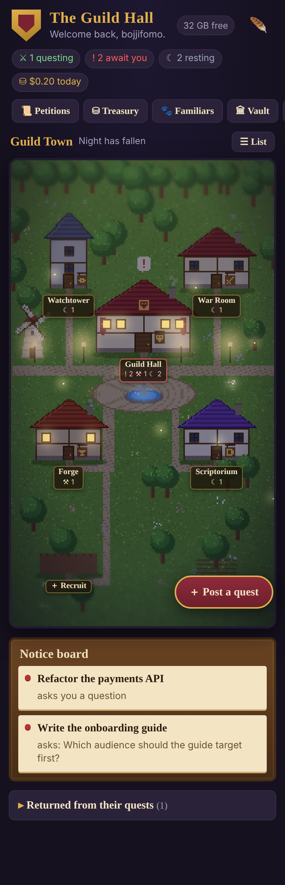

# Agent Office: the Guild Hall

A small web dashboard on the Mac. Every Claude Code session is an adventurer at a quest table,
and you can check on them and give them orders from your phone.

Python 3 standard library only, plain HTML/CSS/JS, no build step, no frameworks.



## Install / update on the Mac

```sh
sh tools/install.sh     # copies to ~/Projects/agent-office, loads com.bojjifomo.agent-office,
                        # puts `office` in ~/.local/bin and the delegation skill in ~/.claude/skills
office doctor           # checks the install
office install-hook     # optional: exact "needs you" when a session waits on a permission prompt
```

Restart: `launchctl kickstart -k gui/$(id -u)/com.bojjifomo.agent-office`

* Mac: `http://127.0.0.1:7777`
* Phone over Tailscale: `http://100.89.176.76:7777`
* Push notifications and the home-screen app need https. Run `tailscale serve --bg --https=443 http://127.0.0.1:7777`
  once, open `https://<your-mac>.<tailnet>.ts.net` on the phone, Share → Add to Home Screen, then 🪶 → *Send ravens to this phone*.
  `install.sh` puts that ts.net name in the Host allowlist for you.
* An external assistant on the public internet is a different door. See [External access](#external-access-tailscale-funnel). Funnel and Serve cannot share a port, so leave Serve on 443 for the phone.

## What's in it

| Part | What it does |
| --- | --- |
| The town | An HD-2D pixel town (drawn in code, no assets): the Guild Hall on the plaza holds your lead sessions, each division is its own building. Agents write at desks, read by the fire, sleep in bed, and walk the road with a scroll when they carry an errand. Day and night follow the clock; tap a building to go inside, tap someone to open them. Under the map, the guild chat (All / Guild / System / Chatter) |
| Life in town | Every agent has a fantasy persona (name, kin and calling, age, quirk, home town, bio, motto). Idle agents walk to **the Tavern** for a break and back to their desk when work starts; they chatter in speech bubbles ("Who broke main?" / "Not me!"). Sessions can be moved into a division's building. Tapping a building shows its roster |
| Profile card | Top of every sheet: persona plus Started as, Division, Project, Branch, Model, Pay today / 7 days / 30 days, Last activity, Last tool, Folder. **✨ Summarize with Haiku** and **✨ Suggest replies** run one-shot Haiku calls (no tools, nothing saved) |
| The hall | Sessions from `~/.claude/projects` and `ps`: questing (working), awaiting your word (a real question, AskUserQuestion, plan approval or a permission prompt), resting, returned, archived |
| Sheet | Recent conversation as light markdown with copy buttons, a message box, a queue (Send now / Remove), Stop |
| Post a quest | New session in a known project folder, a permission mode, a model, optional party leader (project manager) mode |
| The guild | Recruited specialists in `~/Agents/<name>`, grouped into division wings; `office team / who / ask / result` |
| Chain of command | ⚜️ Chain: your programs as **interns** with health checks, a **warden** for each, the **Innovator**, the **Operations Manager** (orchestrator) and the **CEO** as its backup. Broken interns climb warden → ops → CEO → your phone. See [Chain of command](#chain-of-command) |
| Petitions | Update proposals from the guild (`office propose`): read the plan, then Approve & build (a quest that ends in a PR, never a merge), Approve for later, or Reject with a note |
| Usage | 📊 Usage: where the gold goes by person, kind of work (you / chain / guild), model and project, with savings ideas priced from the same tokens and one-tap model switches. See [Usage control](#usage-control) |
| Treasury | Tokens and estimated cost per day, model and session |
| Familiars | Your launchd jobs: running, last run, last error, Run now |
| Vault | Free space, the biggest folders, six fixed cleaners (each needs a phone seal) |
| Scrying | Search across every transcript |
| Ledger | Every action taken from the page, and every token call from outside: messages, quests, errands, seals, cleaners |
| Ravens & seals | Web push to your phone; one-time 6-digit seals for risky actions |

## Security

* Binds to 127.0.0.1 and the Tailscale IP only (never 0.0.0.0). The Tailscale bind retries until that address exists.
* The Host header must be on the allowlist (stops DNS rebinding). Every POST needs `X-Agent-Office: 1` and a matching `Origin`, or it gets a 403. A request with no `Authorization` header still follows exactly these rules.
* Public Funnel traffic and names in `external_hosts` need `Authorization: Bearer <token>`. The token only opens the route list in the next section. A wrong token is 401. Seals still apply to risky quest modes.
* The browser sends ids, never paths or commands. Project folders, cleaners and launchd jobs are looked up server-side, and nothing uses `shell=True`.
* Bypassing permissions and running cleaners need a seal: 6 digits pushed to the phone, stored only as a salted sha256 in memory, valid for 2 minutes, 3 tries, single use, bound to the one action.
* A strict CSP (no inline script or style), and every piece of transcript text is escaped before it becomes HTML.
* Push only goes to known browser push services (Apple, Google, Mozilla, Microsoft).

## External access (Tailscale Funnel)

The phone stays on Tailscale Serve, inside the tailnet. To let Guild Hall (the assistant on another machine) call this dashboard over the public internet, give the server a secret and turn on Funnel. Local pages and tailnet requests do not change.

Tailscale sends public Funnel requests to the same MagicDNS name as Serve, and marks them with `Tailscale-Funnel-Request: ?1`. It sets that header itself and strips any copy the caller sent, so it cannot be forged through the proxy. Those requests need the bearer token even though `install.sh` already put the name in `extra_hosts` for the phone. A Serve request to that name has no such header and keeps working as before.

1. Choose a secret. The environment wins over the file, so a launchd plist can hold it without a second copy in git (`config.json` is gitignored either way):

   ```sh
   # config.json, next to server.py — leave this blank if the environment is set
   "external_token": ""
   ```

   `AGENT_OFFICE_TOKEN` in the server's environment overrides `external_token`. Never commit a real token. Restart the agent after changing it (`launchctl kickstart -k gui/$(id -u)/com.bojjifomo.agent-office`). `install.sh` rewrites the plist, so put the variable back if you keep it there; a value in `config.json` survives install.

2. Optional: list extra Funnel names in `external_hosts`. A name in that list needs the token on every request, header or not, so do not put the phone's MagicDNS name there if the phone should keep opening the page without a token. The Funnel header already covers that name.

   `external_origin` (default `grokbot`) is the marker written on ledger lines for token calls.

3. Turn on Funnel in the background. This is the current Tailscale command (client 1.52 and later; checked against the Funnel docs). It proxies local port 7777 and publishes HTTPS on port 443:

   ```sh
   tailscale funnel --bg 7777
   tailscale funnel status          # prints https://<mac>.<tailnet>.ts.net
   tailscale funnel reset           # turn it off
   ```

   `tailscale funnel 7777` without `--bg` does the same until you stop it. Funnel on macOS needs an open-source Tailscale build, not the Mac App Store app. The last of Serve or Funnel to claim a port wins, and Funnel makes that port public, so do not point Funnel at the port Serve is using for the phone. The tailnet URL `http://100.x.x.x:7777` keeps working either way.

4. From the other machine:

   ```sh
   curl -sS "https://<mac>.<tailnet>.ts.net/api/state" \
     -H "Authorization: Bearer $AGENT_OFFICE_TOKEN"

   curl -sS -X POST "https://<mac>.<tailnet>.ts.net/api/ledger" \
     -H "Authorization: Bearer $AGENT_OFFICE_TOKEN" \
     -H "Content-Type: application/json" \
     -d '{"kind":"chatter","text":"The watch reports all quiet.","by":"Guild Hall"}'
   ```

   `office` sends the same header when `AGENT_OFFICE_TOKEN` is set and `AGENT_OFFICE_URL` is a remote https URL. It does not send the token to `127.0.0.1`, `localhost`, or a Tailscale CGNAT address (`100.64.0.0/10`), so the CLI on the Mac stays on the old rules. Remote `office` can only call the routes below. `office result` and session messages stay on the Mac.

### What a token may call

| | |
| --- | --- |
| Read | `GET /api/state`, `/api/petitions`, `/api/team`, `/api/team/who`, `/api/ledger`, `/api/usage`, `/api/bots`, `/api/orchestrator` (Quill's last brief) |
| Write | `POST /api/petitions` (new petition), `POST /api/petitions/<id>/decide` (approve or reject, with a note), `POST /api/team/ask` (not Quill), `POST /api/job` (a new quest, including `"pm": true`), `POST /api/ledger` (`kind` `guild` or `chatter`, `text`, `by`) |

Anything else, including session send, hiring, launchd, cleaners, seals, push, starting Quill's brief (`POST /api/orchestrator/brief` or `ask` of Quill), and the static page, is 403. `decide` with `"build": true` is 403 as well; building a petition stays on the phone. A risky quest mode still needs a phone seal.

Every accepted token call is a ledger line `kind: external` with `origin` set (default `grokbot`), and that same origin is stamped on the action itself (the quest, the petition, the errand). The town chat has an **External** tab for these lines; `chatter` also shows under Chatter and `guild` under Guild.

A missing or wrong token on a Funnel request or an `external_hosts` name is 401. The failure is written to the server log without the token. After 8 failures from the same client within 10 minutes the answer is 429. Funnel connects from 127.0.0.1 and sets `X-Forwarded-For` to the public client; that address is what the limit counts. A correct token clears the count. A wrong token on localhost is also 401, so a mismatched `AGENT_OFFICE_TOKEN` fails closed. A correct token on localhost does not open the allowlist and does not skip the Origin check.

## Chain of command

```
 🛡️ Guildmaster (you)      approves petitions and seals; gets what nobody below could fix
 👑 CEO (Opus)             backup: takes over when the Operations Manager fails, gets stuck or cannot fix an incident
 ⚔️ Operations Manager     the orchestrator: a round every few hours over every intern, sends the right person
 ✒️ Innovator              reviews interns and incidents every week, files petitions (you decide)
 🗝️ Wardens                one per intern: diagnose and fix their program
 🌱 Interns                your programs, each with fixed health checks
```

**The standing team.** ⚜️ Chain → *Recruit the standing team* (or `office setup`) recruits whoever is missing. Anyone already in
the guild with that name is kept exactly as is. Each person's written role (mission, steps, limits, how they report) is in
`roster.py` and becomes their `CLAUDE.md`:

| Person | Seat | Model | Division | What they do |
| --- | --- | --- | --- | --- |
| Aurelian | CEO | Opus | The Keep | Takes incidents ops could not fix and ops' missed rounds; keeps the purse (budget review) |
| Bram | Operations Manager | Sonnet | The War Room | Rounds over every intern: check, send the warden, escalate, close what he verified |
| Orin | Innovator | Sonnet | The War Room | Weekly review, at most 3 well-argued petitions |
| Lyra | Warden | Sonnet | The Watchtower | RH Wallet Finder, RH Smart LP Finder, LP website, LP Call Bot (never sends to Telegram): restarts, syncs, snapshots, RPC quota, a `RUNBOOK.md` of past fixes |
| Thorne | Warden and reviewer | Sonnet | The Watchtower | Agent Office and Power Meter; reviews every agent pull request (never merges) |

They report to bojjifomo in short casual Indonesian, and all of them carry the same limits: branch plus pull request, no merging
or force-pushing, no deleting data, no secrets, no wallets, two tries and then say so.

Each person's text also covers their actual work: a map of every program and how it runs, the Operations Manager's daily
checklist and report shape (*Sehat / Dikerjakan / Masih terbuka / Butuh kamu*), the CEO's table for choosing a fix, the
innovator's sources for petitions, and strict rules for the LP Call Bot (no Telegram messages, no touching `state.json` or `.env`,
offline tests only). Open anyone in the guild to **edit their role, division and instructions**; *Load the latest standard text*
brings in this version for a standing-team member who joined before it. Saving rewrites their `CLAUDE.md`.

**Known programs.** `office setup` (and *Add every known program that is healthy now* in ⚜️ Chain) finds these in your project
folders and adds the ones whose checks pass right now. A program that is down is skipped with what to do first:

| Program | Checks | Warden |
| --- | --- | --- |
| LP Call Bot | `lp_call_bot/heartbeat` younger than 15 min (the bot touches it on every successful Telegram poll), launchd `com.bojjifomo.lp-call-bot` when installed | Lyra |
| RH Wallet Finder | `rh_wallet_finder/data/wallets.db` younger than 6 h | Lyra |
| RH Smart LP Finder | `http://127.0.0.1:8787/` answers | Lyra |
| Power Meter | `http://127.0.0.1:7788/` answers, launchd `com.bojjifomo.power-meter` when installed | Thorne |

The *Take on an intern* form offers the same list to fill itself in.

**Interns.** Add one in ⚜️ Chain → *Take on an intern*: a name, the program's folder (picked from your project
folders), and at least one check. The checks are fixed code, never shell text:

| Check | Healthy when |
| --- | --- |
| launchd job | it is loaded and its last exit was 0 (picked from your Familiars) |
| Health URL | a GET answers below 400 within 8 seconds |
| Fresh file | the file inside the program's folder changed within the hours you set |

Interns are checked every `check_minutes` (default 5). After `fail_after` failed checks in a row (default 2) an
incident opens and climbs the ladder:

1. **Warden**: gets a brief with the folder, the checks, what failed. When their run ends the intern is checked again.
2. Still down: the **Operations Manager**, with what the warden tried. Skipped when ops is down.
3. Still down: the **CEO**.
4. Still down: **you**, by push ("… is down and needs your word"), with the last report.

An intern that recovers on its own closes its incident. *Send up the chain* moves it one rung by hand, *Mark fixed*
closes it. Agents use `office check <intern>` to confirm a fix and `office incident <id> resolve "<note>"`.

**Rounds.** The Operations Manager makes a round every `ops_every_hours` (default 6) with a situation report
(interns, open incidents, petitions waiting, treasury, launchd errors, the last guild log lines). If a round ends
with an error, or runs longer than `stuck_minutes` (default 90, it is then stopped), ops counts as **down**: you get
a push and the CEO takes over that round and is told to get ops working again. With no Operations Manager
appointed, the CEO makes the rounds. The Innovator reviews every `innovator_every_days` (default 7) and files at
most three petitions.

**Safety.** Chain runs use Claude Code's `auto` permission mode (guarded, no prompts) with `--add-dir` for the
intern folders. Every brief says: changes on a branch with a pull request, never merge to main, never force-push,
never delete data or touch secrets or wallets. `max_auto_per_day` (default 12) caps automatic dispatches; past it
incidents come to you. An empty treasury also sends incidents to you instead of anyone else. Bypassing permissions
still needs a seal. Token callers cannot reach any chain route. *Autopilot* off keeps the checks but nobody moves
until you press a button.

State lives in `chain.json`. Webhook events: `incident.opened`, `incident.escalated`, `incident.resolved`, `ops.down`.

```sh
office chain                          # situation report: interns, health, open incidents
office check "RH Wallet Finder"       # check one intern now (exit 1 when down)
office incident 0fa7a4 resolve "re-ran the sync"
office round ops|innovator|ceo        # start a round now
```

## Usage control

📊 **Usage** reads the transcripts (tokens at API list prices, so an estimate) and shows: today / 7 days / a month at this rate,
the split between *Your own sessions*, *Guild errands* and *Chain*, the split by Opus / Sonnet / Haiku, the biggest spenders with a
model switch each, spend by project, and **ideas** with the saving worked out from the same tokens ("$6 on Opus; the same tokens on
Sonnet cost about $3"). `office usage [days]` prints the same report.

The **CEO keeps the purse**. Every `review_hours` (default 24, `0` turns it off) the CEO gets that report and the model guide
(Haiku for checks, lookups and summaries; Sonnet for everyday coding, rounds and petitions; Opus for hard design and tricky bugs),
and may move people with `office model <name> <haiku|sonnet|opus>`: at most 3 changes a review, written to the guild log, never their
own model. *Budget review now* in ⚜️ Chain or 📊 Usage runs one on demand.

Guard rails, all enforced by the server and not only asked for in a brief:

* **Opus seats** (`opus_seats`, default 2): a move to Opus is refused while all seats are taken.
* Only bojjifomo (the phone) can change the CEO's model.
* **Rationing**: with `daily_budget_usd` set, at `guard_pct` of it (default 80%) the automatic rounds and reviews stop and a push says
  so. Incidents still get through until the treasury is empty, which already holds back new quests.
* Token callers cannot read the report or change models.

## Webhooks

`config.json` holds a list. Each entry is a URL and an optional secret. Delivery is a background thread with a short timeout (`webhook_timeout`, default 5 seconds). A failure is one line on stderr and does not affect the page.

```json
"webhooks": [
  {"url": "https://example.com/guild", "secret": "choose-one", "header": "X-Guild-Token"}
]
```

Leave `header` out to send only the signature. When `secret` is set the body is signed as `X-Guild-Signature: sha256=<hex hmac-sha256 of the raw body>`. If `header` is also set, that header's value is the secret itself. `events` is an optional list; omit it to receive every event.

```json
{"event": "petition.added", "ts": 1710000000.0, "source": "agent-office", "data": {}}
```

| Event | When |
| --- | --- |
| `petition.added` | A petition was filed. `data` is the petition without the plan |
| `petition.decided` | Approved, rejected, or expired (`data.decision`) |
| `petition.closed` | Status became `merged`, `closed`, or `failed` (`data.pr_url` when there is one) |
| `build.started` | The build quest for an approved petition started |
| `quest.finished` | A Claude run ended (`sid`, `ok`, `cost`, `origin`) |
| `familiar.error` | A launchd job showed a new error line |
| `incident.opened` / `incident.escalated` / `incident.resolved` | An intern failed its checks, someone up the chain took it (`data.who`; `you` is your phone), it is healthy again |
| `ops.down` | The Operations Manager failed or got stuck; the CEO takes over |

Pending petitions older than `petition_expire_days` (default 14, `0` turns it off) expire. A new petition whose title is a near-duplicate of an open one for the same app is refused. The hall still keeps at most 200 petitions and drops settled ones first.

After a build quest finishes, a GitHub pull-request URL in its report is stored on the petition. Every `pr_poll_seconds` (default 300, `0` turns it off) the hall asks `gh pr view` when `gh` is on the PATH, otherwise the public GitHub API. `merged` and `closed` update the petition; if GitHub cannot be reached the status stays `building`. A quest that fails before any PR link is `failed`.

## The living town

The clock is Asia/Jakarta, wherever the phone's own zone is set. Adventurers walk the paths to their building when a quest or errand starts, and walk back carrying a little chest when it ends. Resting ones stroll the road. Empty buildings are dimmed; a building with someone at work has lit windows and chimney smoke.

Chatter and External lines (not the raw `GET /api/…` audit) appear as speech bubbles. Guild Hall, the external assistant, stands as the Guildmaster beside the Guild Hall and speaks its own posts.

The sky follows Bitcoin's 24 hour change from CoinGecko, cached for 10 minutes in `weather.json`. Green or flat is sun, a mild drop is cloud, a hard drop is rain. If the fetch fails the last sky stays, or a clear day if there never was one. `GET /api/weather` is on the token allowlist. On a narrow screen the town draws at 1x and skips the blur pass so it stays smooth.

## Gold and raids

`daily_budget_usd` (default `0`) is the day's Claude budget. `daily_gold` (default `100`) is the purse it maps onto. Gold left is `purse × (1 − spent today / budget)`. At `0` the purse stays full and nothing is paused, which is how the hall behaves until you set a budget. When gold hits zero, new quests, errands, petition builds, and Quill's brief wait in `gold.json`. Replies to someone already on a quest still go through. On the phone, tick **Open the strongbox anyway** or press **Let it through** in the Treasury. A token caller cannot do either; `POST /api/job` while the treasury is empty is refused. `GET /api/gold` and `GET /api/raids` are on the allowlist.

A party-leader quest is a raid. The task is a boss with 100 HP. Each finished errand knocks off 34, but not the last point. When the leader's run ends in success the boss falls, the guild log records the victory, and the leader and the party each take 80 XP. The fight is kept in `raids.json`.

## Ranks

Every adventurer keeps XP in `progress.json`. A finished quest grants 10 / 25 / 60 / 120 for Common / Rare / Epic / Legendary. Rarity comes from the petition: high impact and L effort is Legendary, high+M or medium+L is Epic, high or medium or M is Rare, anything else is Common. Approving a petition grants half (at least 5) to the person who filed it. A merged pull request grants the full amount again to whoever built it.

Ranks drive the title in the town: Apprentice at 0 XP, Journeyman at 40, Adept at 120, Master at 300. Level is `1 + XP // 25`. The character sheet (open anyone) shows the XP bar, success rate, thrift, speed, badges, and recent quests. The Guild Hall's quest board lists open petitions with their rarity. Badges (First Quest, 10 Quests, First PR Merged, Zero-Cost Day, Petition Sealed, Legendary Quest) toast once and land in the guild log. Zero-Cost Day is a completed quest whose reported cost is $0.

`GET /api/quests` and `GET /api/progress` are on the token allowlist.

## The Counting House

Quill the Treasurer is always on the roster, stationed in the Counting House (breaks at the Tavern, like any idle adventurer). *Write today's brief* or `office brief` runs `python3 -m orchestrator brief` with `ORCHESTRATOR_READ_ONLY=1` and never `--yes`, so write tools are not offered and cannot be confirmed. The report is kept in `orchestrator.json` and a short line is written to the guild log. Set `orchestrator_root` if this install is not sitting next to the `orchestrator` package. Token callers may read `GET /api/orchestrator` and may not start a brief.

## State files (next to server.py, written atomically)

`config.json` · `names.json` · `archived.json` · `staff.json` · `queue.json` · `helpers.json` ·
`petitions.json` · `chain.json` · `assignments.json` · `orchestrator.json` · `push.json` and `vapid.json` (mode 600) · `ledger.jsonl` (an append-only log)

## Testing a change (never restart the live one while sessions run)

```sh
sh tests/run_copy.sh                         # throwaway copy on :7790 with a fake $HOME and a fake claude
python3 -m unittest discover -s tests        # parsing, status rules, security, runs, team, panels, external token, chain of command
node tests/shoot.js stage1,stage2,stage4     # phone-width screenshots into docs/screens/
```
