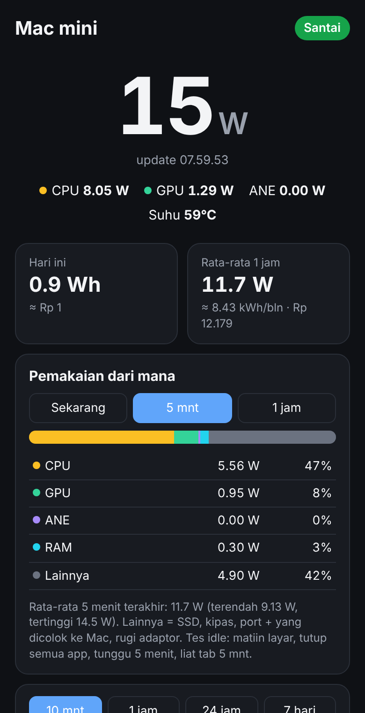

# Power Meter: watt Mac mini, real time, dari HP

Halaman web kecil yang jalan di Mac mini: berapa watt yang lagi kepake **sekarang**
(update tiap 2 detik), lagi kerja atau santai, grafik 10 menit / 1 jam / 24 jam / 7 hari,
total kWh hari ini + perkiraan biaya listrik (Rp), dan riwayat per hari.
Buka dari HP lewat Tailscale, jadi tetep kepantau waktu lu lagi di luar.

Python 3 standard library aja, HTML/CSS/JS biasa, nggak ada build step.



## Pasang di Mac

```sh
cd power-meter
sh tools/install.sh
```

Script-nya:

1. Install [`macmon`](https://github.com/vladkens/macmon) lewat Homebrew kalau belum ada
   (baca sensor daya Mac tanpa sudo).
2. Copy ke `~/Projects/power-meter`, pasang launchd agent `com.bojjifomo.power-meter`
   (nyala sendiri tiap login, restart sendiri kalau mati).
3. Nampilin alamatnya:
   * Mac: `http://127.0.0.1:7788`
   * HP (Tailscale): `http://<ip-tailscale-mac>:7788` (misal `http://100.89.176.76:7788`)

Di HP: buka alamat Tailscale itu di Safari → Share → **Add to Home Screen**, jadi kayak app.
Tailscale di HP harus nyala.

Restart: `launchctl kickstart -k gui/$(id -u)/com.bojjifomo.power-meter`
Log: `~/Projects/power-meter/logs/server.log`

## Angkanya dari mana

| Sumber | Yang diukur | Butuh |
| --- | --- | --- |
| `macmon` (default) | `sys_power`: daya **seluruh Mac mini** dari sensor SMC, paling deket sama yang kebaca di colokan. Plus CPU / GPU / ANE / suhu | `brew install macmon` |
| `powermetrics` (cadangan) | Cuma chip (CPU + GPU + ANE), jadi lebih kecil dari colokan ±4–6 W | root. Tambahin satu baris sudoers: `sudo visudo -f /etc/sudoers.d/powermetrics` → `<user-lu> ALL=(root) NOPASSWD: /usr/bin/powermetrics` |

Catatan: angka dari sensor Mac belum termasuk rugi-rugi adaptor daya internal, jadi colokan
biasanya beberapa watt lebih gede. Mau 100% akurat, pake smart plug yang ada power meter-nya.
Mac mini M-series biasanya idle ~5–8 W, kerja berat 30–60 W (M4 Pro bisa lebih).

## Rincian pemakaian

Kartu **Pemakaian dari mana** misahin total watt jadi:

| Bagian | Artinya |
| --- | --- |
| CPU, GPU, ANE, RAM | Langsung dari sensor chip |
| Lainnya | Total Mac dikurangi bagian di atas: SSD, kipas, port USB / Thunderbolt + apa pun yang dicolok ke Mac, rugi-rugi adaptor |

Tab **Sekarang** (rata-rata beberapa detik), **5 mnt**, dan **1 jam**. Buat ngetes idle: matiin layar, tutup semua
app, tunggu 5 menit, liat tab 5 mnt (ada angka terendah & tertingginya).

Mac mini dayanya dari kabel power ke tembok, nggak dari USB-C monitor (nggak punya input charging USB-C), jadi
monitor nggak ikut keitung. Watt monitor cuma bisa diukur pake smart plug / watt meter di kabel monitornya.
Per aplikasi nggak ada: sensor Mac nggak misahin sampe situ.

Kalau sumbernya `powermetrics`, "Lainnya" nggak ada karena dia cuma ngukur chip.

## Setting

Bikin `config.json` di sebelah `server.py` (nggak ke-commit), isi yang mau diganti aja:

```json
{
  "port": 7788,
  "busy_watts": 15,
  "price_per_kwh": 1444.70,
  "token": ""
}
```

| Kunci | Default | Artinya |
| --- | --- | --- |
| `port` | `7788` | Port web |
| `bind` | `["127.0.0.1", "tailscale"]` | Dengerin di localhost + IP Tailscale (dicari otomatis, dicoba ulang tiap 30 detik kalau Tailscale belum nyala). Nggak pernah `0.0.0.0` |
| `source` | `auto` | `auto` / `macmon` / `powermetrics` / `fake` |
| `interval_ms` | `1000` | Jarak sampel |
| `busy_watts` | `15` | Di atas ini status jadi **Lagi kerja** |
| `price_per_kwh` | `1444.70` | Tarif PLN (Rp/kWh) buat hitung biaya |
| `token` | kosong | Opsional. Kalau diisi, buka sekali pake `http://…:7788/?t=<token>`, abis itu HP inget (cookie). `POWER_METER_TOKEN` di environment menang |
| `keep_days` | `90` | Data per menit disimpen berapa hari (`power.db`) |

## API

Semua `GET`, JSON:

| Route | Isinya |
| --- | --- |
| `/api/now` | Sampel terakhir (watt total, CPU, GPU, ANE, suhu), status `busy`/`idle`/`offline`, Wh + biaya hari ini, rata-rata 1 jam, proyeksi kWh/bulan |
| `/api/live?seconds=600` | Titik per detik, maksimal 1 jam terakhir |
| `/api/window?seconds=300` | Rata-rata per bagian (total, CPU, GPU, ANE, RAM, Lainnya) + watt terendah & tertinggi di rentang itu, 2 detik sampai 1 jam |
| `/api/history?hours=24` | Rata-rata per menit / 5 menit / jam |
| `/api/daily?days=14` | kWh, rata-rata, puncak, biaya per hari |

Contoh dari laptop lain di tailnet:

```sh
curl -s http://100.89.176.76:7788/api/now | python3 -m json.tool
```

## Coba tanpa Mac

```sh
python3 server.py --source fake --bind 127.0.0.1    # data palsu, buka http://127.0.0.1:7788
python3 -m unittest discover -s tests               # test
```
